# CacomixtlePad Android App

<div align="center">
  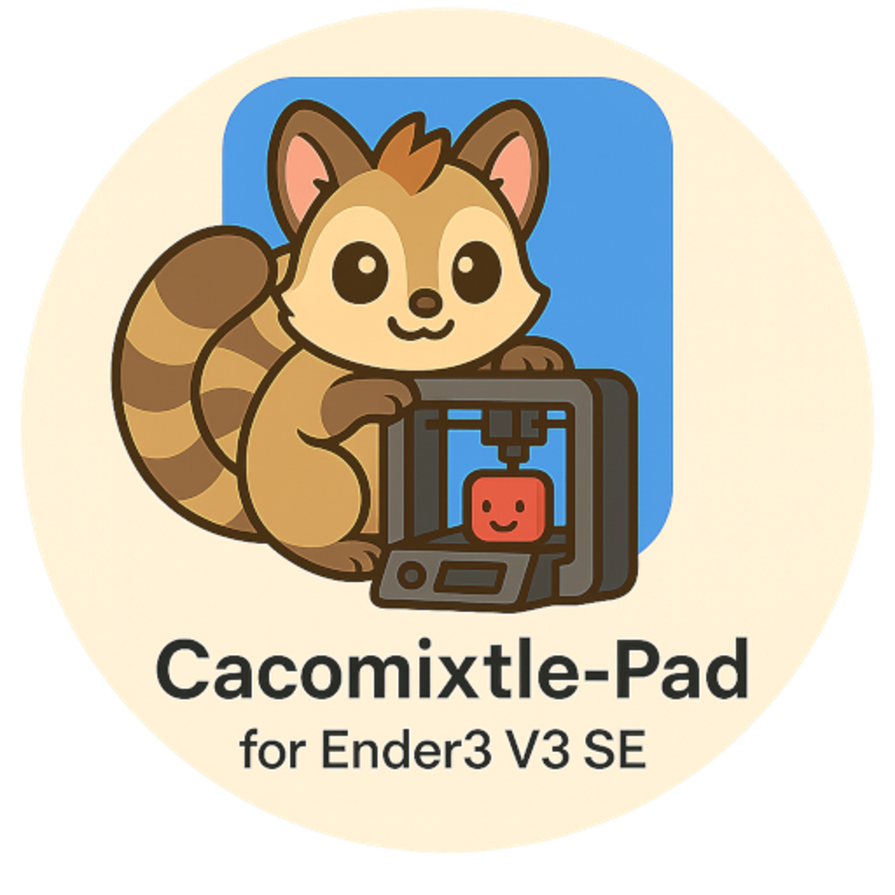
</div>

<br>

[Cacomixtle](https://unamglobal.unam.mx/global_revista/cacomixtle-adaptaciones-del-bosque-a-la-ciudad-de-mexico/)Pad is an Android application to control your Ender 3 V3 SE 3D Printer (and probably any Marlin 2 based printer).  
I built it as a quick, responsive, and modern replacement for the LCD.

---


<br>


<br>

---

## Index

- [Installation](#installation)
- [Features](#features)
  - [Home Page](#home-page)
  - [Print Page](#print-page)
  - [Printing Page](#printing-page)
  - [Prepare Page](#prepare-page)
  - [Settings Page](#settings-page)
- [Connection](#connection)
- [Postman/Bruno Upload](#postmanbruno-upload)
- [OrcaSlicer Setup](#orcaslicer-setup)
- [Cura Slicer Setup](#cura-slicer-setup)
- [Hints](#hints)
- [Disclaimer](#disclaimer)
- [License](#license)

---

## Installation
> [!TIP]
>
> 1. Download the latest Release from [Release page](https://github.com/navaismo/cacomixtlePad/releases).
> 2. Install the APK in your cellphone.
> 3. Be sure that the Printer's Firmware uses the Baud Rate 115200, due to the Android limitation. 
> 4. You can get the Printer's Firmware From: [Latest Release of Printer's Firmware without Gcode Preview](https://github.com/navaismo/Ender-3V3-SE) download the ZIP with 115Kbps string in it.
> 5. Enjoy.
>

## Features

### Home Page

<div align="center">
  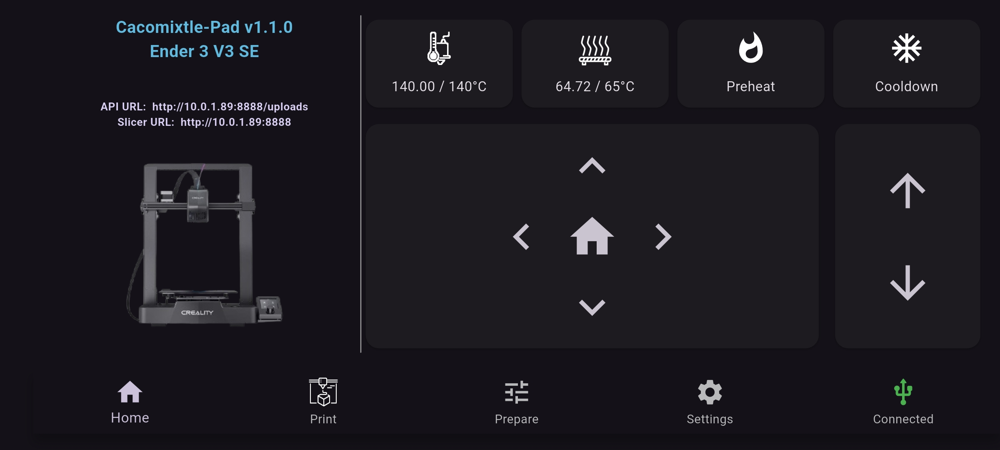
</div>

>- [x] XYZ Movement Controller
>- [x] Set & See Hotend Temperature
>- [x] Set & See Bed Temperature
>- [x] Cooling Bed & Hotend with one click
>- [x] Preheat shortcuts for PLA, PETG, TPU & ABS Materials
>- [x] Information for the API URL
>- [x] Information for the Slicer URL

<br>

### Print Page

<div align="center">
  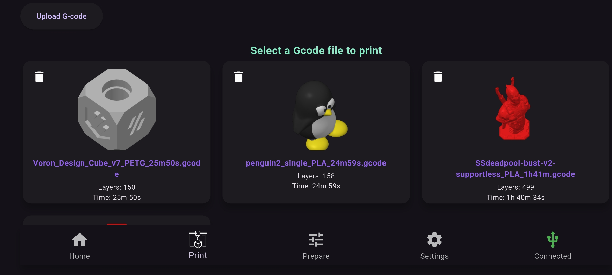
</div>

>- [x] Preview of the Gcode Files
>- [x] Layer information
>- [x] Time information
>- [x] Select a local file from phone to print
>- [x] Delete File
>- [x] Upload files from PostMan
>- [x] Upload files from OrcaSlicer or Cura

<br>

### Printing Page

<div align="center">
  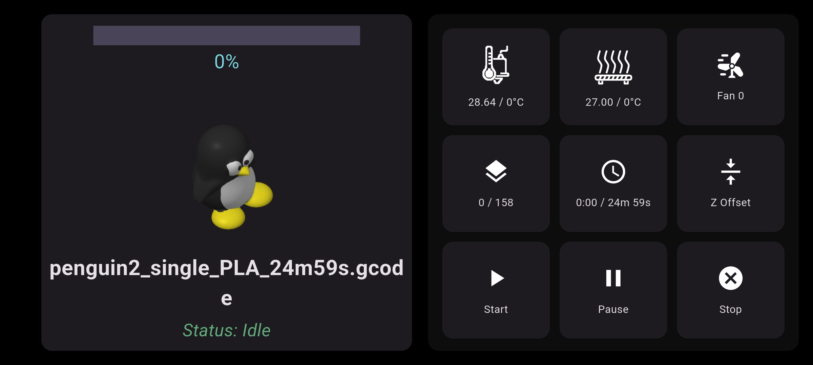
</div>

>- [x] Preview of the File
>- [x] Progress of the job
>- [x] Status of the job
>- [x] Control for Hotend Temperature
>- [x] Control for Bed Temperature
>- [x] Control for Fan Speed
>- [x] Layer Progress
>- [x] Time Progress
>- [x] Control for Z offset
>- [x] Start Button
>- [x] Pause/Resume Button
>- [x] Cancel Button

<br>

### Prepare Page

<div align="center">
  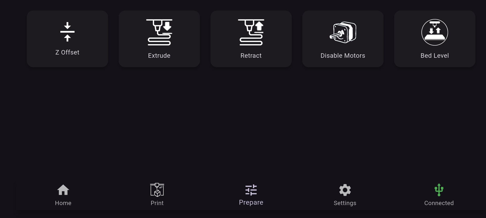
</div>

>- [x] Setup Z Offset  
  <div align="center">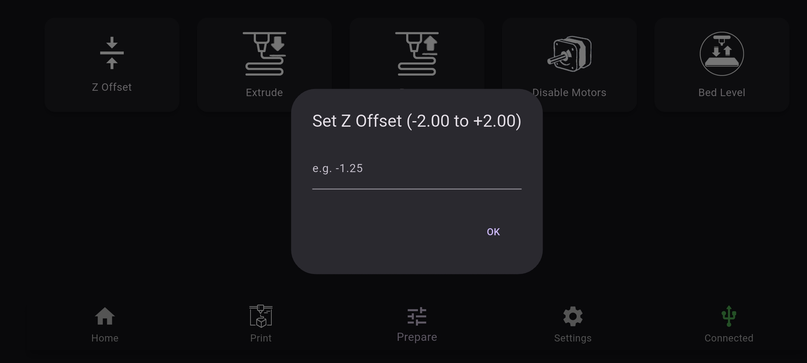</div>

>- [x] Extrude & Retract material  
  <div align="center">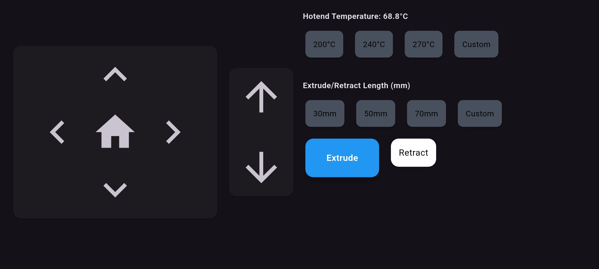</div>

>- [x] Disable Motors  
  <div align="center">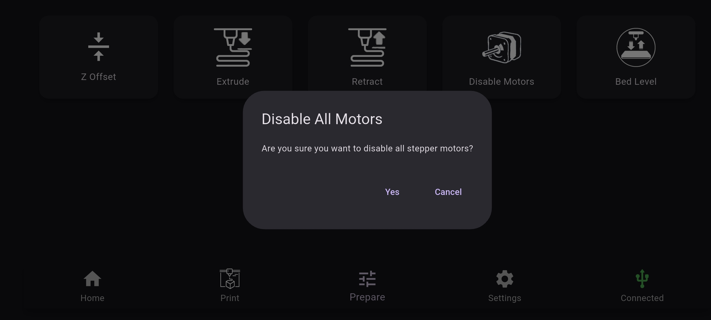</div>

>- [x] View or start a new Bed Level  
  <div align="center">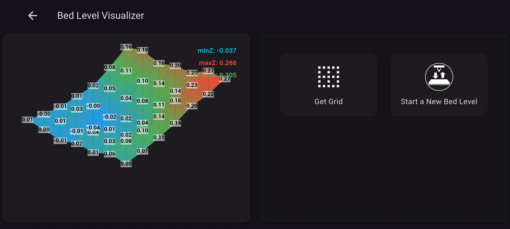</div>

<br>

### Settings Page

<div align="center">
  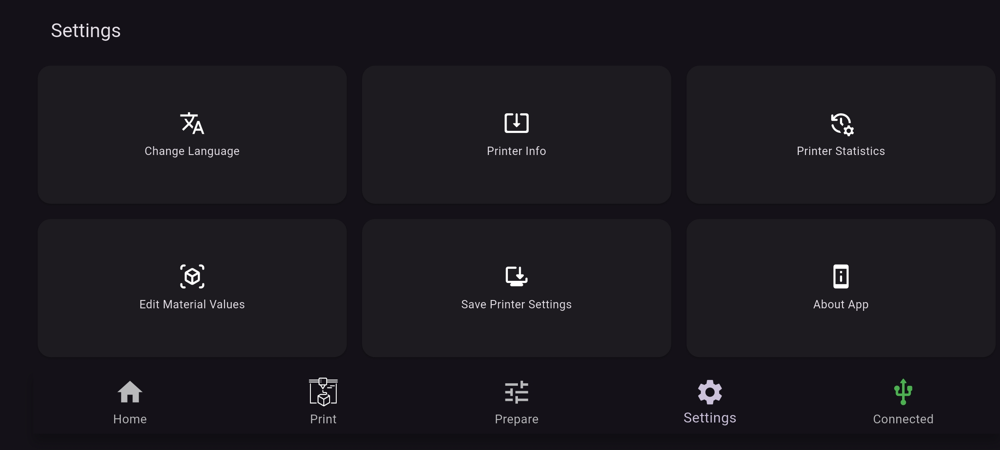
</div>

>- [x] Change App Language
>- [x] Get Printer's Firmware information
>- [x] Get Printer's Statistics
>- [x] Edit Preheat temperatures for materials
>- [x] Save Printer's configuration
>- [x] About the android application

---

## Connection

Use an OTG connector for your phone, and connect the serial cable from the OTG adapter to the printer's port.

<div align="center">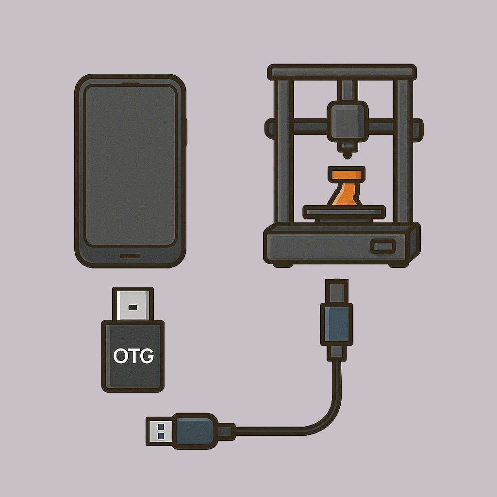</div>
<br><br>

---

## Postman/Bruno Upload

While the application is running and no print jobs are working, you can upload files using Postman, Bruno, or any other API client.  
Open **API key** on the Home Page and copy the key. Use it as the `X-Api-Key` header.
Use this cURL request (replace the IP with the one reported in your Home Page as: API URL and replace `YOUR_API_KEY` with your key):

```bash
curl --location 'http://10.0.1.80:8888/uploads' \
--header 'X-Api-Key: YOUR_API_KEY' \
--form 'file=@"/run/user/1000/doc/c894368d/M73Cube_PLA_5m53s.gcode"'
```

---

## OrcaSlicer Setup

- Open the slicer and click on the Remote Settings (WiFi icon):

  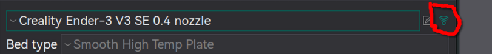

- Select Octoprint as the type and enter the IP reported in the home page. Paste the key from **Home → API key** into the API key field. Then click on test.

  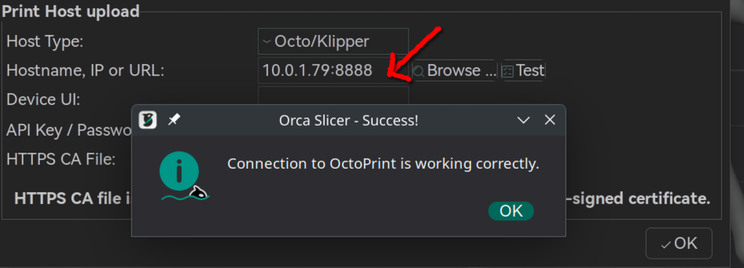

- After that you can upload the file. Upload & Print is not supported.

---

## Cura Slicer Setup

- Open the slicer and click on Manage Printers (you need the Octoprint Plugin installed)
- Click on Add.
- Enter Name, IP, Port, and slash

  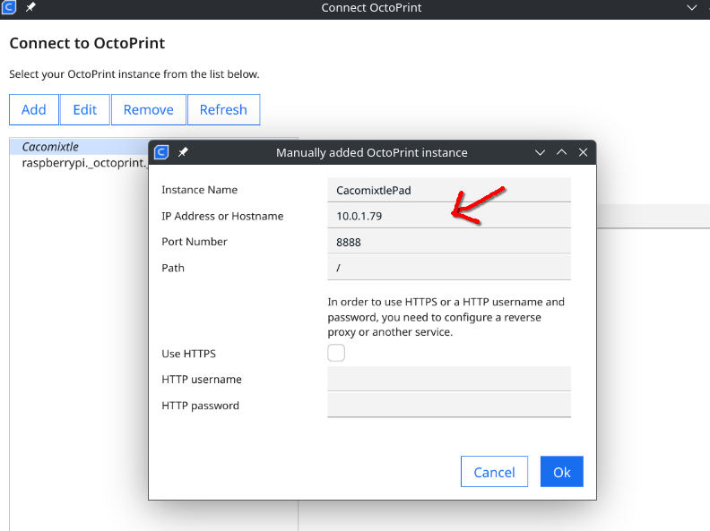

- On the next screen, select the added item.
- Paste the key from **Home → API key** into the API key field.
- Unselect all options.
- Click on Connect

  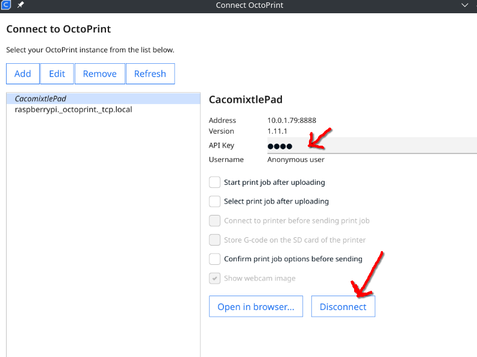

- After that you can upload the file. Upload & Print is not supported.

---

## Hints

- Printing continues when you navigate between screens inside CacomixtlePad. Return to **Print → Active print** to view its controls. The last job state is saved. After a process restart, an unfinished job appears as interrupted; it does not resume printer movements automatically.
- Pause drains accepted movements, lifts Z by up to 30 mm, and parks toward the rear (Y maximum minus 5 mm) within reported soft limits. Resume restores XY at the raised height, then Z and the original command modes before sending the next file line. If homing, position, limits, or clearance cannot be verified, we pause in place with a visible message. We temporarily hold the motors during pauses and restore the runtime idle timeout afterward. Cancel waits for the in-flight command, disables the heaters and fan, and drains accepted movements without moving the head to a fixed position. Heating or probing already in progress can delay cancellation. See [printing and mesh changes](docs/PRINTING_AND_MESH.md) for the prerequisites and hardware checks.
- Uploads require the API key and are blocked during active jobs. Existing filenames return `409`; rename or delete the old file first. Limits are 256 MiB per file and 512 MiB per request.
- Debug builds now communicate with real hardware too; automatic debug simulation has been removed.

- Although during print time the cellphone does not lock the screen, make a quick test before printing large jobs or it can be lost.
- Consider the battery of your cellphone for long prints; you don't want to lose your job because the cellphone died.
- Check if your phone can be charged while using OTG: [OTG Charging Compatibility Sheet](https://docs.google.com/spreadsheets/d/1pbKAELzvTrMVm6NpDpK8TfQR33w3QHQEgqkcGdbPFI0/edit?usp=sharing) (from Octo4A project).

---

## Disclaimer

**BAU:**  
I provide this app as is, without warranty. See [LICENSE](LICENSE) for the full warranty and liability terms.

**TL;DR:**  
If your house burns down because this app malfunctioned, you cannot sue me.

---

## License

I share this project under the [GNU Affero General Public License v3.0 only](LICENSE) (`AGPL-3.0-only`).

For local checks, CI and signed APKs, see [Development and release](docs/RELEASE.md).
