# CacomixtlePad Android App

<div align="center">
  
</div>

<br>

[Cacomixtle](https://unamglobal.unam.mx/global_revista/cacomixtle-adaptaciones-del-bosque-a-la-ciudad-de-mexico/)Pad is an Android application to control your Ender 3 V3 SE 3D Printer (and probably any Marlin 2 based printer).  
I built it as a quick, responsive, and modern replacement for the LCD.

---


<br>

<details open>
<summary>Earlier phone demo</summary>

This recording shows the earlier interface. You can see the current screens below.


</details>

<br>

---

## Index

- [Installation](#installation)
- [Features](#features)
  - [Home Page](#home-page)
  - [Print Page](#print-page)
  - [Printing Page](#printing-page)
  - [Prepare Page](#prepare-page)
  - [Bed Mesh](#bed-mesh)
  - [Settings Page](#settings-page)
  - [Small Screens and Forms](#small-screens-and-forms)
- [Connection](#connection)
- [Postman/Bruno Upload](#postmanbruno-upload)
- [OrcaSlicer Setup](#orcaslicer-setup)
- [Cura Slicer Setup](#cura-slicer-setup)
- [Hints](#hints)
- [Disclaimer](#disclaimer)
- [License](#license)

---

## Installation
> [!TIP]
>
> 1. Download the latest Release from [Release page](https://github.com/navaismo/cacomixtlePad/releases).
> 2. Install the APK in your cellphone.
> 3. Be sure that the Printer's Firmware uses the Baud Rate 115200, due to the Android limitation. 
> 4. You can get the Printer's Firmware From: [Latest Release of Printer's Firmware without Gcode Preview](https://github.com/navaismo/Ender-3V3-SE) download the ZIP with 115Kbps string in it.
> 5. Enjoy.
>

## Features

We refreshed the layout so you can reach the controls on smaller screens, keep
forms above the keyboard, and return to an active print from any screen. The
G-code thumbnail stays loaded while progress and temperatures update.

These screenshots come from our current Flutter screens with simulated printer
state, example files, and example network addresses. We did not connect a printer
to capture them. You can reproduce them with the [screenshot tool](docs/SCREENSHOTS.md).

### Home Page

<div align="center">
  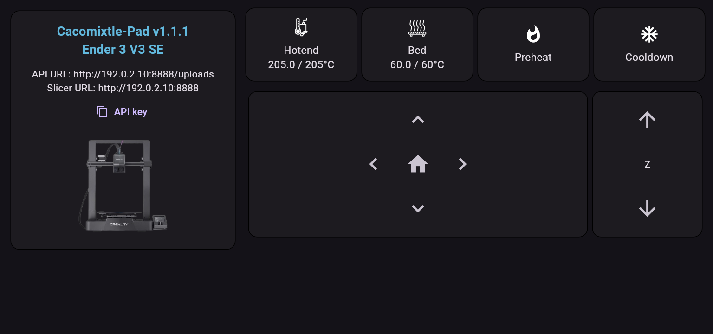
</div>

> - [x] Move XYZ and home the printer
> - [x] Set and read hotend and bed temperatures
> - [x] Cool down the bed and hotend with one click
> - [x] Preheat shortcuts for PLA, PETG, TPU, and ABS
> - [x] Find your API and slicer URLs
> - [x] View and copy your upload API key

<br>

### Print Page

<div align="center">
  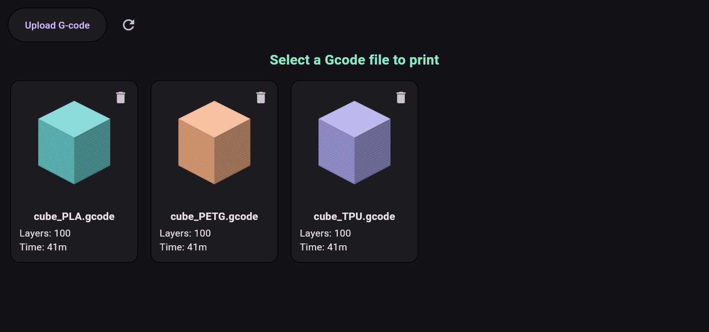
</div>

> - [x] Preview your G-code files, layer counts, and time estimates
> - [x] Select a local file from your phone
> - [x] Delete files when no print is active
> - [x] Upload from Postman, Bruno, OrcaSlicer, or Cura

<br>

### Printing Page

<div align="center">
  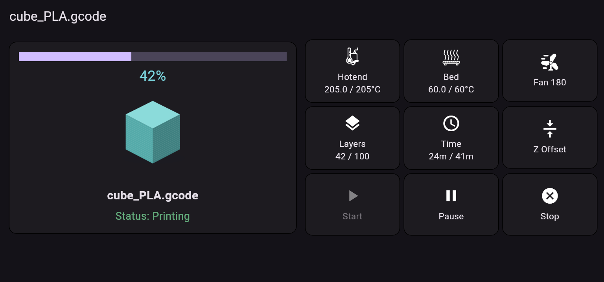
</div>

> - [x] Follow progress, status, layers, and time
> - [x] Adjust hotend temperature, bed temperature, fan speed, and Z offset
> - [x] Pause with a verified lift and rear parking when firmware checks pass
> - [x] Resume by returning to the saved position before the next file line
> - [x] Cancel with cooldown and checked parking
> - [x] Return to the job through the global **Active print** button

You can leave this page while printing. When parking finishes, **Resume** becomes
available; Z offset changes stay disabled throughout pause and return.

<details open>
<summary>Paused print and the global Active print button</summary>

<div align="center">
  
  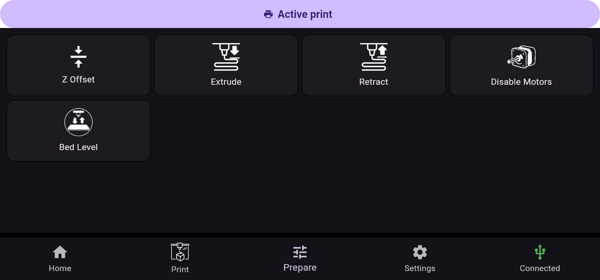
</div>

</details>

<br>

### Prepare Page

<div align="center">
  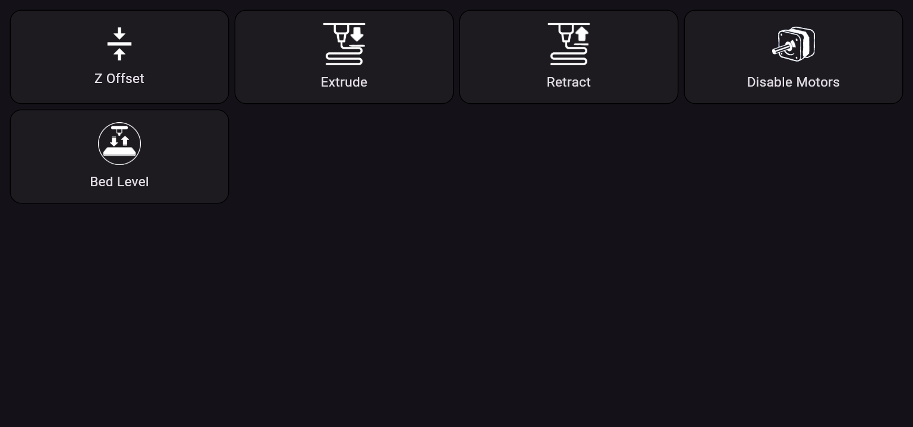
</div>

> - [x] Set the global probe Z offset
> - [x] Extrude and retract material
> - [x] Confirm before disabling motors
> - [x] Open the bed mesh or start a new leveling pass

<details open>
<summary>Z offset, extrusion, and motor controls</summary>

<div align="center">
  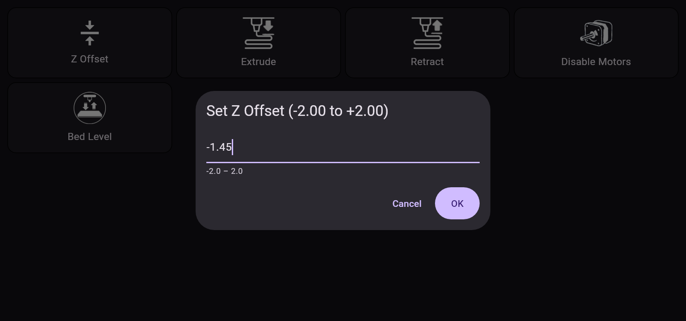
  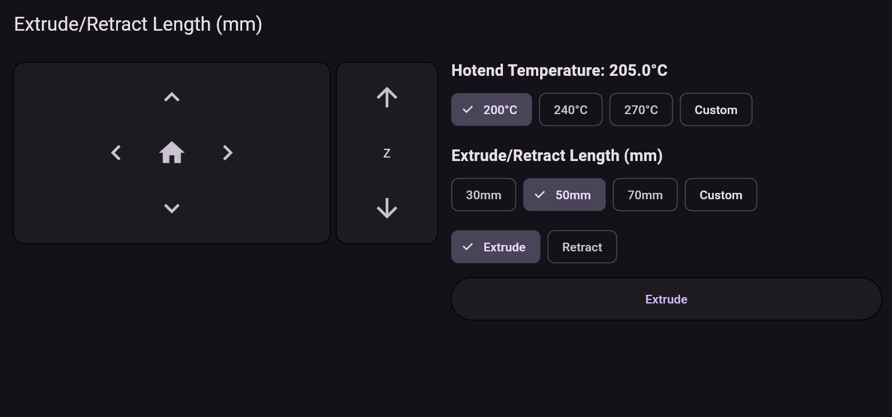
  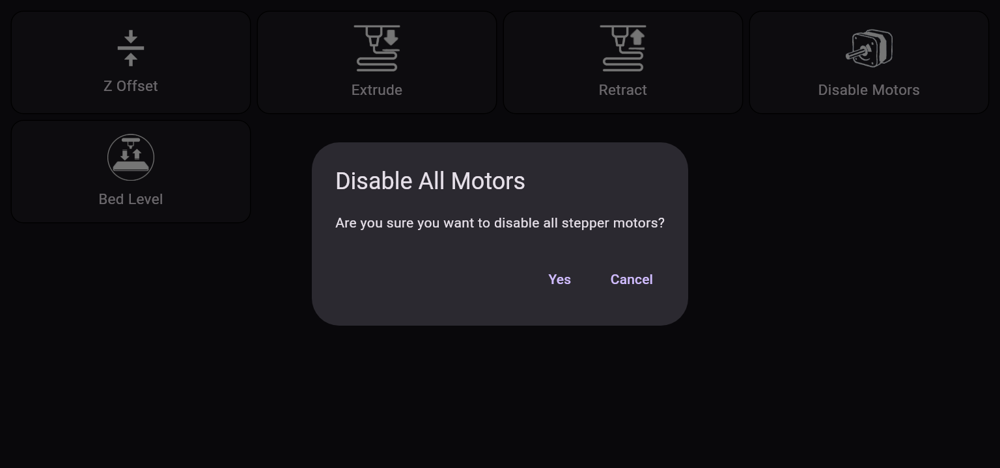
</div>

</details>

<br>

### Bed Mesh

<div align="center">
  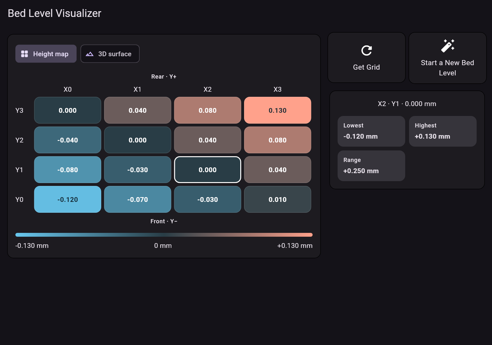
</div>

> - [x] Select a point to inspect its reported height
> - [x] Switch between the height map and 3D surface
> - [x] Read the minimum, maximum, and range beneath the mesh controls
> - [x] Refresh the mesh or run a new leveling pass
> - [x] Keep the previous mesh visible if a refresh fails

The point labels are mesh indices, not XY distances. Selecting a point currently
shows its height; moving the nozzle to a point and adjusting it in 0.01 mm steps
remain [planned calibration work](docs/MESH_POINT_CALIBRATION_REVIEW.md).

<details open>
<summary>3D surface view</summary>

<div align="center">
  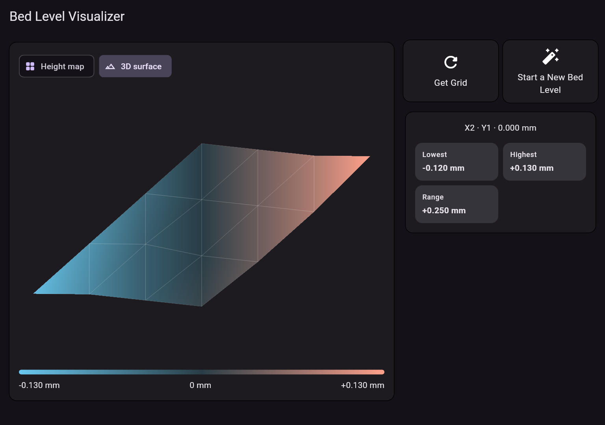
</div>

</details>

<br>

### Settings Page

<div align="center">
  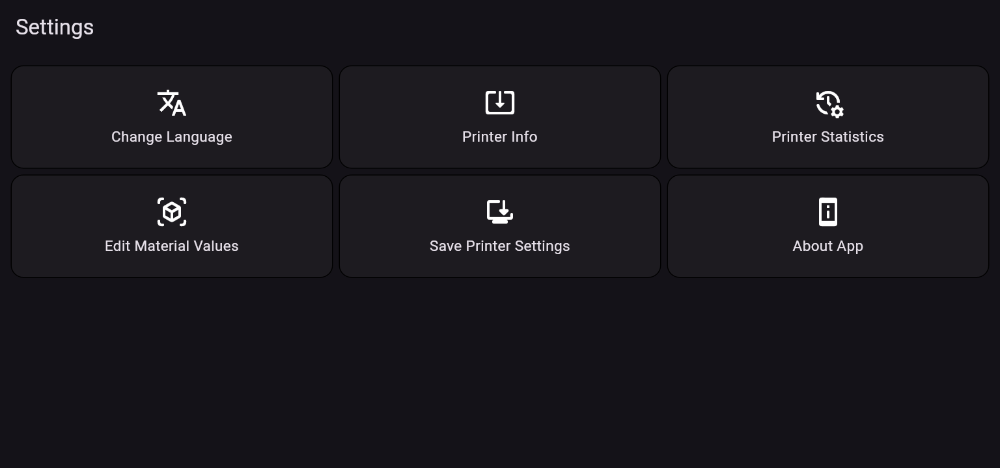
</div>

> - [x] Choose from seven app languages
> - [x] Read firmware information and printer statistics
> - [x] Edit preheat temperatures for each material
> - [x] Save the printer configuration
> - [x] Read app information

<details open>
<summary>Material presets</summary>

<div align="center">
  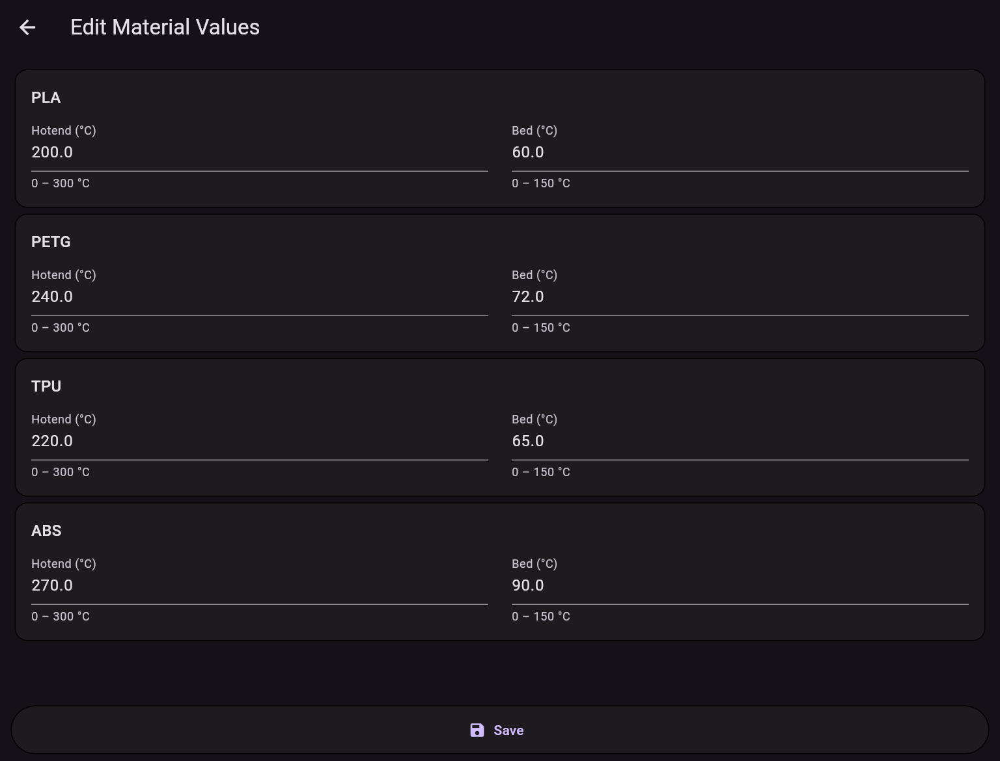
</div>

</details>

<br>

### Small Screens and Forms

Controls wrap and pages scroll as space gets tighter. Numeric forms switch to a
compact row when the keyboard leaves little height, and material fields stack
on narrow screens. You can still reach Save and confirmation buttons.

<div align="center">
  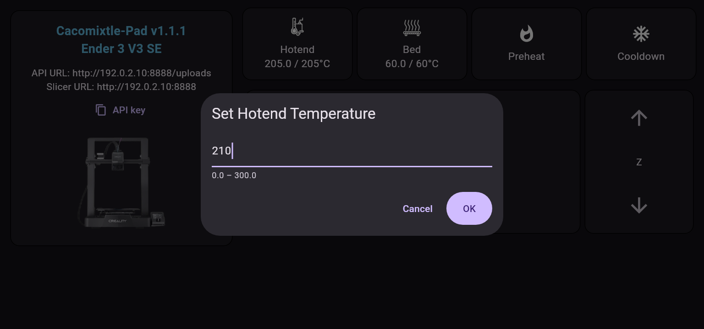
</div>

The compact example below uses a 568 × 320 viewport with 180 pixels reserved for
the keyboard. The dark lower area represents that reserved space; Android's
keyboard itself is not rendered by the screenshot tool.

<div align="center">
  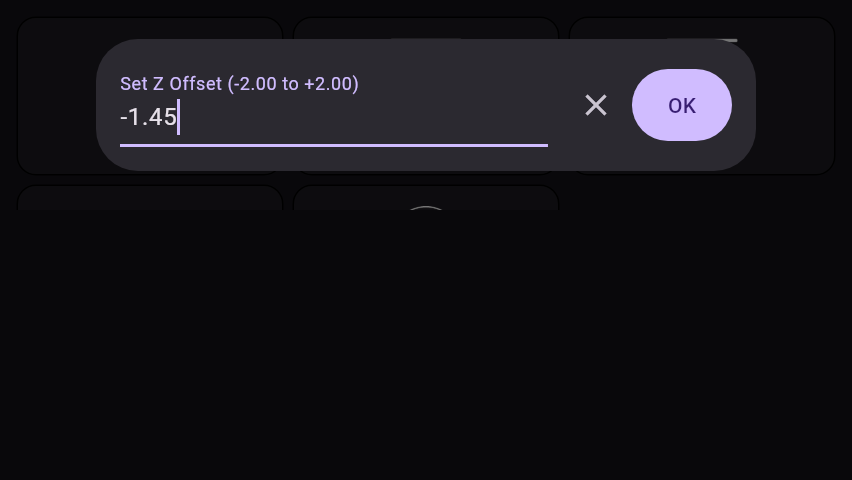
</div>

---

## Connection

Use an OTG connector for your phone, and connect the serial cable from the OTG adapter to the printer's port.

<div align="center"></div>
<br><br>

---

## Postman/Bruno Upload

While the application is running and no print jobs are working, you can upload files using Postman, Bruno, or any other API client.  
Open **API key** on the Home Page and copy the key. Use it as the `X-Api-Key` header.
Use this cURL request (replace the IP with the one reported in your Home Page as: API URL and replace `YOUR_API_KEY` with your key):

```bash
curl --location 'http://10.0.1.80:8888/uploads' \
--header 'X-Api-Key: YOUR_API_KEY' \
--form 'file=@"/run/user/1000/doc/c894368d/M73Cube_PLA_5m53s.gcode"'
```

---

## OrcaSlicer Setup

- Open the slicer and click on the Remote Settings (WiFi icon):

  

- Select Octoprint as the type and enter the IP reported in the home page. Paste the key from **Home → API key** into the API key field. Then click on test.

  

- After that you can upload the file. Upload & Print is not supported.

---

## Cura Slicer Setup

- Open the slicer and click on Manage Printers (you need the Octoprint Plugin installed)
- Click on Add.
- Enter Name, IP, Port, and slash

  

- On the next screen, select the added item.
- Paste the key from **Home → API key** into the API key field.
- Unselect all options.
- Click on Connect

  

- After that you can upload the file. Upload & Print is not supported.

---

## Hints

- Printing continues when you navigate between screens inside CacomixtlePad. Use the **Active print** button at the top of any screen to return to its controls. After a successful cancellation, the live progress resets and you return to Home; the last job record remains available. After a process restart, an unfinished job appears as interrupted; it does not resume printer movements automatically.
- Pause drains accepted movements, lifts Z by up to 30 mm, and parks toward the rear (Y maximum minus 5 mm) within reported soft limits. Resume restores XY at the raised height, then Z and the original command modes before sending the next file line. If homing, position, limits, or clearance cannot be verified, we pause in place with a visible message. We temporarily hold the motors during pauses and restore the runtime idle timeout afterward. Cancel waits for the in-flight command, disables the heaters and fan, drains accepted movements, and attempts the same safe lift and rearward parking. If the checks cannot be satisfied, cancellation completes in place with a warning on Home. Heating or probing already in progress can delay cancellation. See [printing and mesh changes](docs/PRINTING_AND_MESH.md) for the prerequisites and hardware checks.
- Uploads require the API key and are blocked during active jobs. Existing filenames return `409`; rename or delete the old file first. Limits are 256 MiB per file and 512 MiB per request.
- Debug builds now communicate with real hardware too; automatic debug simulation has been removed.

- Although during print time the cellphone does not lock the screen, make a quick test before printing large jobs or it can be lost.
- Consider the battery of your cellphone for long prints; you don't want to lose your job because the cellphone died.
- Check if your phone can be charged while using OTG: [OTG Charging Compatibility Sheet](https://docs.google.com/spreadsheets/d/1pbKAELzvTrMVm6NpDpK8TfQR33w3QHQEgqkcGdbPFI0/edit?usp=sharing) (from Octo4A project).

---

## Disclaimer

**BAU:**  
I provide this app as is, without warranty. See [LICENSE](LICENSE) for the full warranty and liability terms.

**TL;DR:**  
If your house burns down because this app malfunctioned, you cannot sue me.

---

## License

I share this project under the [GNU Affero General Public License v3.0 only](LICENSE) (`AGPL-3.0-only`).

For local checks, CI and signed APKs, see [Development and release](docs/RELEASE.md).
